# MonoCode Remote Dev Box

<p align="center">
  <strong>A hardened, containerized remote development environment for MonoCode orchestrating AI coding agents alongside custom Skills and Model Context Protocol (MCP) servers.</strong>
</p>

<p align="center">
  <a href="https://github.com/visualfusion/monocode-server/releases"></a>
  <a href="LICENSE"></a>
  
  
  
  <a href="https://github.com/hardbeat920/monocode"></a>
</p>

<br />

A hardened, containerized remote development environment for [MonoCode](https://github.com/hardbeat920/monocode) orchestrating AI coding agents (Claude Code, OpenAI Codex, Google Antigravity / ACP) alongside custom Skills and Model Context Protocol (MCP) servers.

Optimized for self-hosted deployment on servers running Coolify, Portainer, or standard Docker Compose.

---

## Architecture

[MonoCode](https://github.com/hardbeat920/monocode) is a multi-agent orchestrator for AI coding assistants. This server environment decouples resource-heavy builds, language servers, subagents, and git worktrees from your local computer and executes them reliably and persistently on your remote server.

```mermaid
flowchart LR
    subgraph LocalMachine["Local Machine (Mac / Windows / Linux)"]
        MonoCodeApp["MonoCode Desktop App"]
        SSHTunnel["SSH Tunnel / Port Forwarding<br>(Port 2222 -> 127.0.0.1:3774)"]
    end

    subgraph RemoteServer["Remote VPS / Server (Coolify / Docker)"]
        direction TB
        
        subgraph Container["MonoCode Dev Box Container"]
            SSHD["OpenSSH Daemon<br>(Key-Only, No Root)"]
            HostDaemon["monocode-host<br>(127.0.0.1:3774)"]
            
            subgraph Agents["AI Coding Agents"]
                Claude["Claude Code CLI<br>(@anthropic-ai/claude-code)"]
                Codex["OpenAI Codex CLI<br>(@openai/codex)"]
                Antigravity["Antigravity / ACP<br>(Refined ACP & agy)"]
            end
            
            HostDaemon --> Agents
        end
        
        subgraph Volumes["Persistent Volumes"]
            VHome[("monocode_home<br>(Logins, Tokens, SSH Keys)")]
            VWorkspace[("monocode_workspaces<br>(Projects & Git Repos)")]
            VHostKeys[("monocode_ssh_host_keys<br>(Stable Host Fingerprint)")]
            VSkills[("monocode_skills<br>(Agent Prompts & Skills)")]
        end
        
        Container --- Volumes
    end

    MonoCodeApp <--> SSHTunnel
    SSHTunnel <--> SSHD
    SSHD <--> HostDaemon
```



- **Zero Public Exposure**: The internal `monocode-host` daemon binds strictly to `127.0.0.1:3774`. Access is achieved exclusively via private, encrypted SSH tunnels.
- **Persistent Sessions & Auth**: Docker volumes preserve your CLI auth logins (Pro subscriptions, API tokens), project worktrees, and shell history across restarts and image updates.
- **Stable Host Keys**: SSH server keys are automatically persisted in a dedicated volume, preventing `WARNING: REMOTE HOST IDENTIFICATION HAS CHANGED!` errors during rebuilds.
- **Resource Protection**: CPU and memory limits prevent heavy builds from exhausting your VPS host.
- **Multi-Agent Out-of-the-Box**: Pre-installed and configured with Claude Code, OpenAI Codex, and Google Antigravity ACP.

---

## Included Components

| Component | Details |
| :--- | :--- |
| **Base System** | Ubuntu 24.04 LTS (`x86_64`) |
| **User** | `coder` (UID 1000, unprivileged, passwordless sudo enabled) |
| **Toolchains** | Node.js 22 LTS (`npm`, `pnpm`, `bun`), Python 3.12 with `uv` & `uvx`, Git |
| **Utilities** | `ripgrep`, `fd-find`, `jq`, `tmux`, `build-essential`, `curl`, `rsync` |
| **Agent: Claude** | `@anthropic-ai/claude-code` (`claude`) |
| **Agent: Codex** | `@openai/codex` (`codex`) |
| **Agent: Antigravity** | Google Antigravity CLI (`agy`) + Refined ACP Server (`agy_acp_server.par`) |
| **Orchestrator** | `monocode-host` running under `supervisord` |

---

## Quick Start

### 1. Deploy via Coolify (Recommended)

1. In your Coolify dashboard, create a new Resource:
   - Select **Private Repository** (or **Public Repository** if forked).
   - Point to this repository.
   - Build Pack: **Docker Compose**.
2. Configure **Environment Variables** (see [Environment Variables](#environment-variables)).
3. Click **Deploy**.

### 2. Deploy via Docker Compose CLI

```bash
git clone https://github.com/your-username/monocode-server.git
cd monocode-server

# Copy example environment configuration
cp .env.example .env

# Build and start the container
docker compose up -d --build
```

---

## SSH Setup

The container listens on host port `2222` by default.

### 1. Add your SSH Public Key

Use the helper script to copy your key:

```bash
./scripts/setup-keys.sh ~/.ssh/id_ed25519.pub your-server-ip
```

Or inject it manually via Docker:

```bash
cat ~/.ssh/id_ed25519.pub | ssh your-server "docker exec -i \$(docker ps -q --filter name=monocode-dev-box | head -n 1) sh -c 'mkdir -p /home/coder/.ssh && cat >> /home/coder/.ssh/authorized_keys && chmod 600 /home/coder/.ssh/authorized_keys && chown -R coder:coder /home/coder/.ssh'"
```

### 2. Configure Local SSH Config (`~/.ssh/config`)

Add the machine entry to your local `~/.ssh/config`:

```ssh-config
Host remote-monocode
    HostName <your-server-ip-or-domain>
    Port 2222
    User coder
    IdentityFile ~/.ssh/id_ed25519
    StrictHostKeyChecking accept-new
```

Verify connection:

```bash
ssh remote-monocode
```

---

## Authenticating AI Agents

Log in to the server once via SSH to authenticate your AI providers:

```bash
ssh remote-monocode

# 1. Anthropic Claude Code Pro
claude

# 2. OpenAI Codex Pro
codex login

# 3. Google Antigravity
agy
```

All tokens and sessions are stored in the persistent volume `/home/coder` and survive container rebuilds.

---

## Connecting with MonoCode Desktop App

1. Launch **MonoCode** on your local workstation.
2. Navigate to **Settings** &rarr; **Connections** &rarr; **Add Machine**.
3. Select your configured SSH alias (`remote-monocode`) or host IP with port `2222`.
4. MonoCode will automatically establish the tunnel, detect `monocode-host`, and show the available providers:
   ```text
   Providers: codex, claude, antigravity
   ```
5. You can now launch agent sessions and work on remote repositories seamlessly.

---

## Centralized Skills & MCP Management

MonoCode Dev Box provides a single source of truth for custom agent skills and Model Context Protocol (MCP) servers, automatically translated and symlinked across all three coding agents (Claude Code, OpenAI Codex, and Google Antigravity).

### 1. Centralized Skills (`~/.skills/`)
Place any skill directory containing a `SKILL.md` into `/home/coder/.skills/<skill-name>/`.
All agents automatically discover them:
- **Claude Code**: symlinked to `~/.claude/skills/<skill-name>`
- **OpenAI Codex**: symlinked to `~/.codex/skills/<skill-name>`
- **Google Antigravity**: symlinked to `~/.gemini/skills/`

### 2. Centralized MCP Servers (`~/.mcp/mcp-servers.json`)
Configure your MCP servers once in standard format at `/home/coder/.mcp/mcp-servers.json`:

```json
{
  "mcpServers": {
    "umami": {
      "url": "https://analytics.visualfusion.de/mcp",
      "headers": {
        "Authorization": "Bearer <TOKEN>"
      }
    },
    "github-mcp-server": {
      "command": "npx",
      "args": ["-y", "@modelcontextprotocol/server-github@latest"],
      "env": {
        "GITHUB_PERSONAL_ACCESS_TOKEN": "<TOKEN>"
      }
    }
  }
}
```

Running `sync-mcp` automatically translates and distributes configurations to:
- **Claude Code**: `~/.claude.json` (supports HTTP endpoints & stdio)
- **OpenAI Codex**: `~/.codex/config.toml` (supports `[mcp_servers.*]`)
- **Google Antigravity**: `~/.gemini/config/mcp_config.json` (bridges HTTP servers via `mcp-remote`)

---

## CLI Shortcuts & Commands

The server includes pre-configured utility commands and short aliases in your shell:

| Command | Short Alias | Description |
| :--- | :--- | :--- |
| `mc-status` | `monocode-status` | Display status of supervisor services, listening ports, agent versions, installed skills, and MCP servers. |
| `mc-restart` | `monocode-restart` | Restart the `monocode-host` daemon cleanly via `supervisorctl`. |
| `mc-logs` | `monocode-logs` | View recent logs from `monocode-host` (`mc-logs -f` to follow live). |
| `sync-all` | – | Run complete synchronization: skills (`sync-skills`), MCPs (`sync-mcp`), and Antigravity tokens (`sync-auth`). |
| `sync-skills` | – | Synchronize skills from `~/.skills/` to Claude, Codex, and Antigravity. |
| `sync-mcp` | – | Translate and distribute `~/.mcp/mcp-servers.json` to all agents. |
| `sync-auth` | `sync-antigravity-auth` | Sync Antigravity CLI OAuth credentials to the Antigravity ACP daemon. |

---

## Environment Variables

Configure these either in Coolify's environment UI or in your `.env` file:

| Variable | Default | Description |
| :--- | :--- | :--- |
| `MONOCODE_SSH_PORT` | `2222` | Host port mapped to container SSH daemon. |
| `TZ` | `Europe/Berlin` | Timezone inside the container. |
| `MONOCODE_CPU_LIMIT` | `2.5` | Max CPU cores allocated to the container. |
| `MONOCODE_MEMORY_LIMIT`| `3072M` | Max RAM allocated to the container. |
| `ANTHROPIC_API_KEY` | *(optional)* | Anthropic API key (alternative to interactive Pro login). |
| `OPENAI_API_KEY` | *(optional)* | OpenAI API key. |
| `CODEX_API_KEY` | *(optional)* | OpenAI Codex API key. |
| `GITHUB_TOKEN` | *(optional)* | Personal access token for GitHub operations. |

---

## Security & Hardening

1. **No Direct Daemon Exposure**: `monocode-host` strictly binds to `127.0.0.1:3774`. Only SSH port `2222` is exposed.
2. **Key-Only SSH Hardening**: Password authentication is disabled (`PasswordAuthentication no`); root login is forbidden (`PermitRootLogin no`).
3. **Host Isolation**: The host Docker socket (`/var/run/docker.sock`) is not mounted into the container.
4. **Volume Persistence**:
   - `monocode_workspaces`: `/home/coder/workspace`
   - `monocode_home`: `/home/coder`
   - `monocode_ssh_host_keys`: `/etc/ssh/host_keys`
   - `monocode_skills`: `/home/coder/.skills`

---

## License

Released under the [MIT License](LICENSE).

